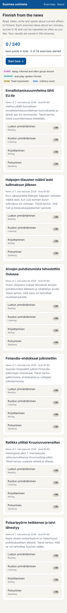

# Suomea uutisista – Finnish current-affairs exercises

Reading, listening, writing and speaking exercises in Finnish about current events in Finland, at roughly B1–B2 level.
Each exercise takes about ten minutes, is scored out of 10 and can be retried as often as you like.
Scores are saved in the browser (`localStorage`), with export and import on the *Tietoja* page for moving between devices.

**Open it:** <https://qualitycoding.github.io/finnish-exercises/>

## What's inside

Six launch themes (news situation on 7 November 2026), four exercises each, plus one new theme a week:

| Theme | Area | Topic |
|---|---|---|
| Ennallistamissuunnitelma lähti EU:lle | 1 Environment | The government sends its draft nature restoration plan to the European Commission |
| Halpojen tilausten määrä laski tullimaksun jälkeen | 2 Economy | Fewer low-value parcels reach Finland after the customs duty |
| Aivojen puhdistumista tehostettiin Oulussa | 3 Science and health | A University of Oulu study on clearing the brain |
| Finlandia-ehdokkaat julkistettiin | 4 Culture | The Finlandia prize nominees |
| Ratikka ylittää Kruunuvuorensillan | 5 Everyday life | The Kruunusillat tram line opens in Helsinki |
| Polaaripyörre heikkenee ja talvi lähestyy | 6 Weather | An early polar vortex breakdown and the start of winter |

| Exercise | How it is scored (10 items, 1 point each) |
|---|---|
| **Luku** (reading) | Article with tap-to-reveal glossary and a short invented dialogue; multiple choice and true/false. |
| **Kuuntelu** (listening) | Script read aloud by the browser's Finnish voice (speed control, play by part); 8 questions and 2 dictation sentences (word accuracy of at least 90 % scores 1, at least 70 % scores a half). |
| **Kirjoitus** (writing) | Inflect words (a half point if only ä/ö or a single typo is wrong), build sentences in neutral word order, translate (scored on required keywords, with a model answer). Plus an unscored free-writing task with checklist, model text and auto-saved draft. |
| **Puhe** (speaking) | Read sentences aloud and answer questions. Speech recognition (`fi-FI`) compares what you said with the target (best of three attempts). Without speech recognition, or if you prefer, you listen to the model and assess yourself. |

### Slang and register labels

Every glossed word carries a label so it is clear how informal it is:
**SLANGI** (slang, informal and often tied to a group, for example *duuni*, *fillari*, *mutsi*),
**PUHEKIELI** (everyday spoken Finnish, for example *mä*, *onks*, *toi*),
**IDIOMI** (fixed expression), and plain **SANA** for ordinary vocabulary.
Each reading text ends with an invented dialogue (clearly marked *keksitty esimerkki*) where the colloquial words appear in context.
A word is labelled slang only when two independent sources confirm it; the evidence is recorded in the theme's content note.

### Browser support for speech

- Text-to-speech uses `speechSynthesis`, which all mainstream browsers have; you need a Finnish voice installed in the device's text-to-speech settings. The listening page says which voice it found, and Chrome on desktop may have no Finnish voice.
- Speech recognition uses `SpeechRecognition`/`webkitSpeechRecognition`: Chrome, Edge and Safari. Firefox has it only behind a flag, so there the speaking exercises use self-assessment. Chrome sends the audio to Google's speech service for recognition.



## Weekly refresh

A scheduled task adds one new theme every week from that week's Finnish news, following [REFRESH.md](REFRESH.md).
New themes appear first on the start page; existing themes are never changed, so saved scores stay valid.

## Content and sources

The texts are written for language learning from news reports, and the sources are linked at the bottom of each reading exercise.
Every fact used in an exercise has two independent sources (different publisher groups), recorded in `content-notes/<id>.md`.
Listening scripts are written for the exercise. Nothing is copied from the sources, and the texts name no private persons. The news situation may have changed since the date shown.

## Development

No build step: plain HTML, CSS and ES modules, served as-is by GitHub Pages (branch `main`, folder `/`).

```sh
npm ci                      # Playwright 1.63.0 for the browser tests
npx playwright install chromium   # only if a Chromium is not already installed
npm test                    # validate data + unit tests + end-to-end tests in headless Chromium
npm run serve               # local server; open the printed URL
npm run screenshots         # phone-sized screenshots into docs/screenshots
```

- `data/manifest.json` lists the theme files in order; `data/themes/<id>.json` holds one theme with its four exercises.
- Glossed words use the markup `[[shown|Finnish gloss · English|label]]`, where label is `slangi`, `puhekieli`, `idiomi` or empty.
- `tools/validate.mjs` checks that every exercise has exactly 10 scored items, that answers are consistent (model answers hit their own keywords, word-order sentences rebuild, answer indices are in range), that markup is well-formed, that each reading text contains slang, and that texts are a ten-minute length.
- `tools/check-notes.mjs` checks that every theme has a content note with facts sourced from at least two publisher groups.
- `tests/e2e.test.mjs` answers every exercise correctly (expects 10/10) and wrongly, checks that scores persist across reloads, retry, navigation, the half-point rule, speech synthesis and the self-assessment fallback. The Web Speech API is replaced by a fake in tests.

### Adding a theme

1. Follow [REFRESH.md](REFRESH.md): copy a file in `data/themes/`, change `id`, texts and questions (10 items per exercise), and write `content-notes/<id>.md`.
2. Add the theme as the first entry of `data/manifest.json`.
3. Run `npm test` and push. CI runs the same checks.

## Licence

[Apache License 2.0](LICENSE)
